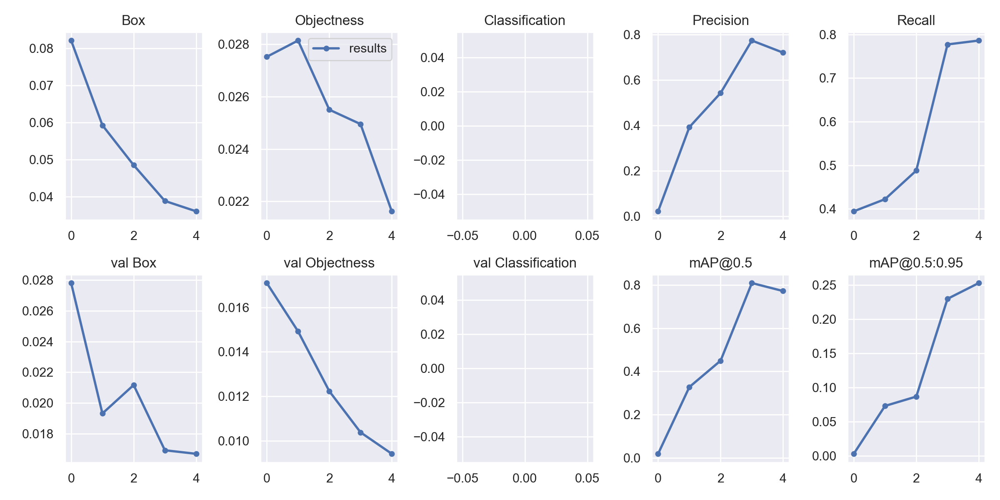
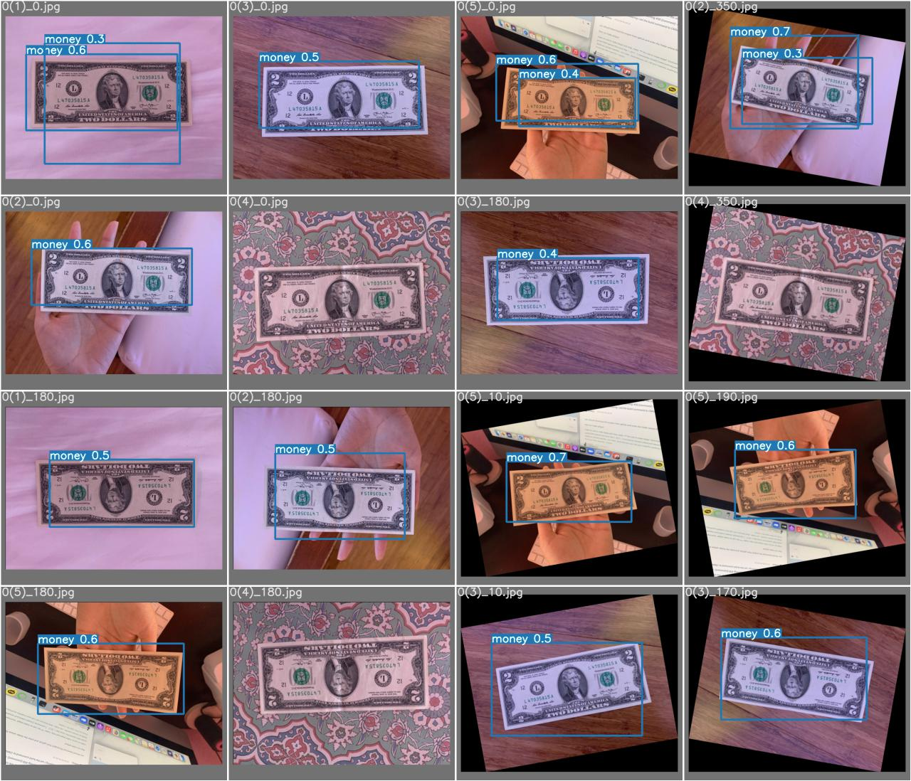
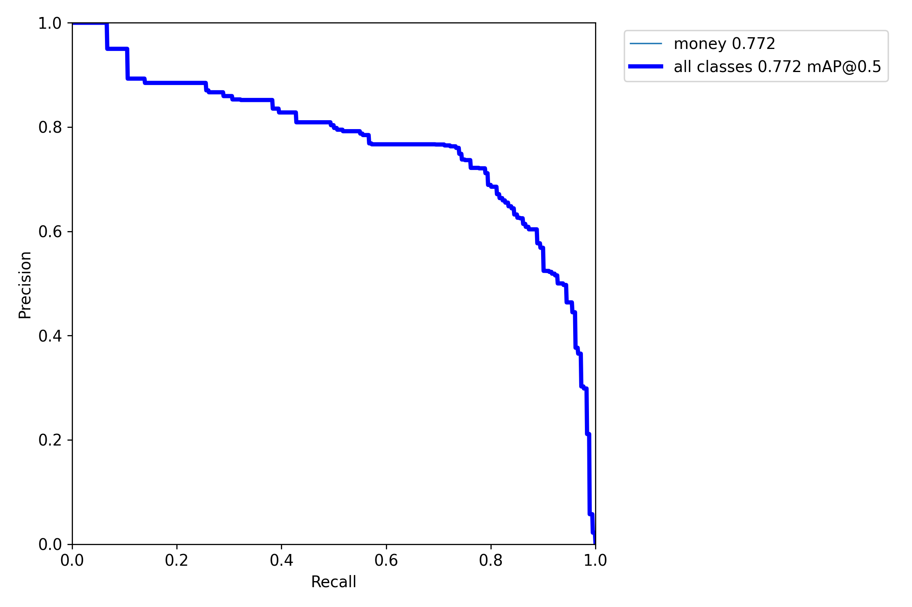
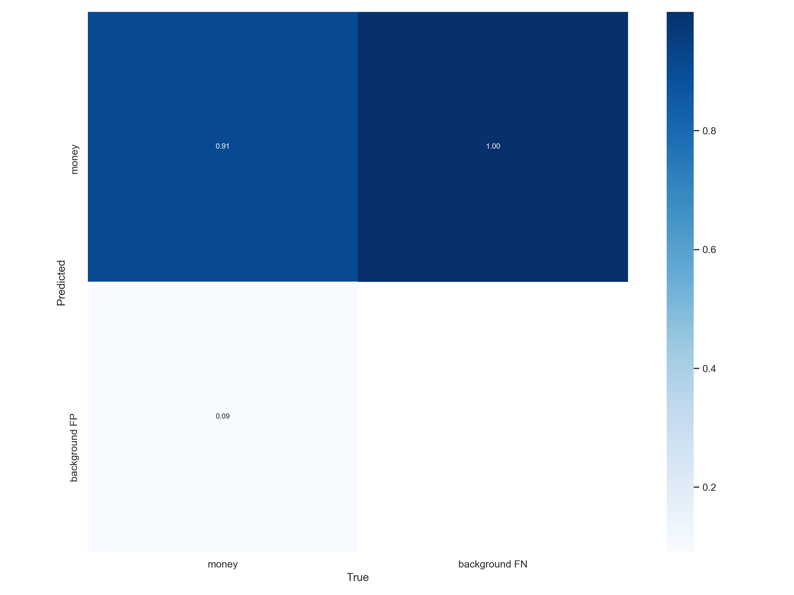

# Object Detection with YOLOv5

An independent machine learning project I completed at UCLA: training a YOLOv5 model to detect paper money bills in images.

## Data
- ~540 training images and 180 validation images of paper money bills, one class ("money")
- Rotated images so the model detects bills held at any angle

## Approach
- Model: YOLOv5s (pretrained by Ultralytics), fine-tuned in Python with PyTorch
- Training: 5 epochs, image size 640, batch size 16, CPU only (about 1.1 hours)

## Results
- mAP@0.5: 0.77 · Precision: 0.72 · Recall: 0.79
- Real-time webcam detection at about 4 frames per second on CPU
- Live webcam test: detected a $2 bill in real time with 0.88 confidence (shown below)


### Training progress


### Validation predictions


### Precision-recall curve and confusion matrix
 

## What I learned
- **Starting from a pretrained model goes a long way.** Fine-tuning YOLOv5s on only ~540 images reached 0.77 mAP@0.5 in 5 epochs on a regular CPU. Training from scratch would have needed far more data and time.
- **The data matters as much as the model.** Adding rotated images helped the model find bills held at different angles, as real people hold them in front of a camera.
- **There's still room to improve.** The model finds bills reliably (0.77 mAP@0.5), but its boxes are less precise (0.25 mAP@0.5:0.95). Next steps would be more varied photos (different lighting and backgrounds), longer training on a GPU, and separate classes for each denomination ($1, $5, $20).
- **Debugging is part of the job.** My first live webcam run crashed with `'NoneType' object has no attribute 'shape'`, which meant the program wasn't getting frames from the camera. I traced the error back through the code, fixed it, and got real-time detection working.

## Files
- `github/best.pt`: trained model weights
- `github/results.txt`: scores for each epoch
- `github/opt.yaml`, `github/hyp.yaml`: training settings and hyperparameters

## How to run
```
git clone https://github.com/ultralytics/yolov5
cd yolov5
pip install -r requirements.txt
python train.py --img 640 --batch 16 --epochs 5 --data data/coco.yaml --weights yolov5s.pt
python detect.py --source 0 --weights best.pt --conf 0.5
```
Note: `data/coco.yaml` was edited to point to my own `rotated_dataset` of money images instead of the COCO dataset.

## Credits
YOLOv5 by [Ultralytics](https://github.com/ultralytics/yolov5).
